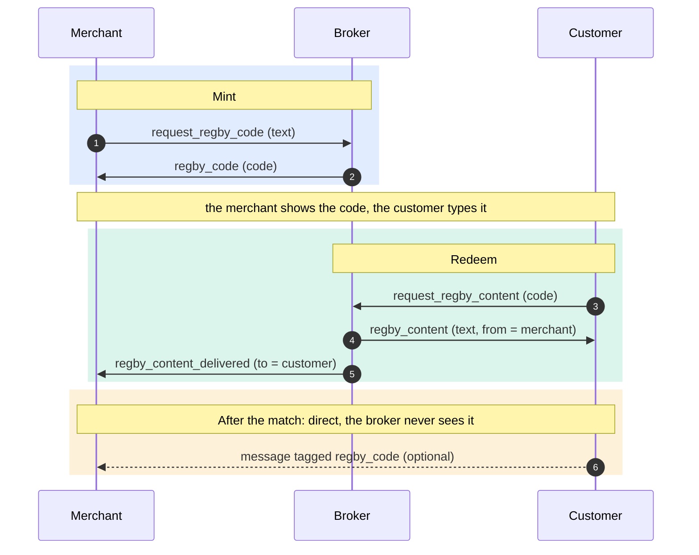

# regby-middleware

Nostr broker for **ReGBY**: BLIK-style 8-digit codes for the ZenTenPay
wallet.

A merchant sends the broker any text (typically a `defito://` payment
request) in an encrypted Nostr DM and gets back an 8-digit code. The customer
types the code into their wallet, which sends it to the broker and receives
the merchant's text. The broker then tells each side who the other was.



Events 1 to 5 go through the broker. Event 6 does not: after the match the
two users message each other directly, and the customer's client tags its
message (in the payment case, the `defifrom://` confirmation) with the code,
so the merchant can tell it apart from a stranger's. Details:
[docs/spec.md, After the match](docs/spec.md#after-the-match).

A code works once, within one minute of the merchant's request. After that it
answers `regby_code_expired` until it is an hour old, then `regby_code_locked`
until 72 h, and only then can the number be issued again.

Every message is a NIP-04 encrypted kind 4 DM on dedicated DM relays that
serve a DM only to its author and its recipient
([Read access](docs/protocol.md#read-access)). The broker holds **no funds and
no wallet keys**, only its own Nostr key, and never interprets the content it
carries: validating it is the recipient's job.

## Documentation

| doc | for |
| --- | --- |
| [docs/spec.md](docs/spec.md) | Public protocol spec, for client implementers: events 1 to 5, failures, event 6 and match records |
| [docs/protocol.md](docs/protocol.md) | Wire format, intents, failure states, code lifecycle, safeguards |
| [docs/flow-examples.md](docs/flow-examples.md) | Every event of a full exchange, tag by tag |
| [docs/configuration.md](docs/configuration.md) | Every environment variable, for the broker and the audit sink |
| [docs/deployment.md](docs/deployment.md) | Containers, audit sink setup, CI deploy, operations, backups, upgrades |
| [docs/audit-events.md](docs/audit-events.md) | The audit table: columns, events, reasons |
| [docs/audit-queries.sql](docs/audit-queries.sql) | Ready-made audit queries |
| [docs/recipient-checks.md](docs/recipient-checks.md) | Content checks the app must do, now that the broker does none |

## Quick start

Requires Node 22.5 or newer (`node:sqlite`).

```bash
npm install
cp .env.example .env      # set REGBY_PRIVATE_KEY and REGBY_RELAYS
npm run dev               # broker, restarts on change
```

The boot log prints the broker's `pubkey`: the app must hardcode the same
value as `REGBY_MIDDLEMAN_PUBKEY`. Set `REGBY_EXPECTED_PUBKEY` to have the
broker check it. Use a separate key for local runs, or the local broker will
answer production traffic on the shared relays.

`REGBY_RELAYS` must only list relays with that read rule. Codes ride in
plaintext tags, so on a public relay any reader can see a live code and redeem
it before the customer does.

### With Docker

```bash
docker compose up -d --build                       # broker only
docker compose -f docker-compose.yml -f docker-compose.audit.yml up -d --build   # broker + audit sink
```

Full setup, including the audit database and CI: [docs/deployment.md](docs/deployment.md).

### Audit sink locally

The sink needs a Postgres reachable over verified TLS and its CA file.

```bash
# in .env, alongside the broker's settings:
#   REGBY_AUDIT_URL=http://127.0.0.1:8787/events
#   REGBY_AUDIT_TOKEN=<32+ characters>
#   REGBY_AUDIT_DATABASE_URL=postgres://...
#   REGBY_AUDIT_DATABASE_CA=certs/db-ca.pem
npm run dev:audit-sink    # in a second terminal
```

## Scripts

| script | does |
| --- | --- |
| `npm run dev` / `npm run dev:audit-sink` | Run from source with `tsx`, reload on change |
| `npm run build` | Compile to `dist/` (tests excluded) |
| `npm start` / `npm run start:audit-sink` | Run the compiled build |
| `npm run typecheck` | `tsc --noEmit` over sources and tests |
| `npm test` | Node test runner. The Postgres tests run only with `REGBY_AUDIT_TEST_DATABASE_URL` and `REGBY_AUDIT_TEST_DATABASE_CA` set |

## Layout

| path | role |
| --- | --- |
| `src/index.ts` | Broker entry point, graceful shutdown |
| `src/server.ts` | Broker: dedup, rate limits, dispatch of mint and redeem |
| `src/protocol.ts` | Intents, tags, envelope checks (binary, size, code shape) |
| `src/nostr.ts` | Relay pool, NIP-42 AUTH, NIP-04, publish, NIP-09 deletions |
| `src/store.ts` | SQLite code store, per-UTC-day file rotation |
| `src/config.ts` | Broker config loading and boot-time checks |
| `src/env.ts` | Env readers shared by both config loaders |
| `src/rate-limit.ts`, `src/blacklist.ts` | Sliding-window limiter, guesser block list |
| `src/bounded-map.ts`, `src/deletion-queue.ts` | Bounded seen-id set, pending NIP-09 deletions |
| `src/audit.ts` | Audit wire contract shared by broker and sink |
| `src/audit-sender.ts` | Broker side: bounded queue, batched POST, backoff |
| `src/audit-sink/` | Audit service: HTTP intake, Postgres history, retention |
| `src/logger.ts`, `src/process.ts`, `src/time.ts` | JSON logging, process lifecycle, clocks |
| `src/**/*.test.ts`, `src/audit.fixture.ts` | Tests, next to the code they cover; a shared audit record fixture |
