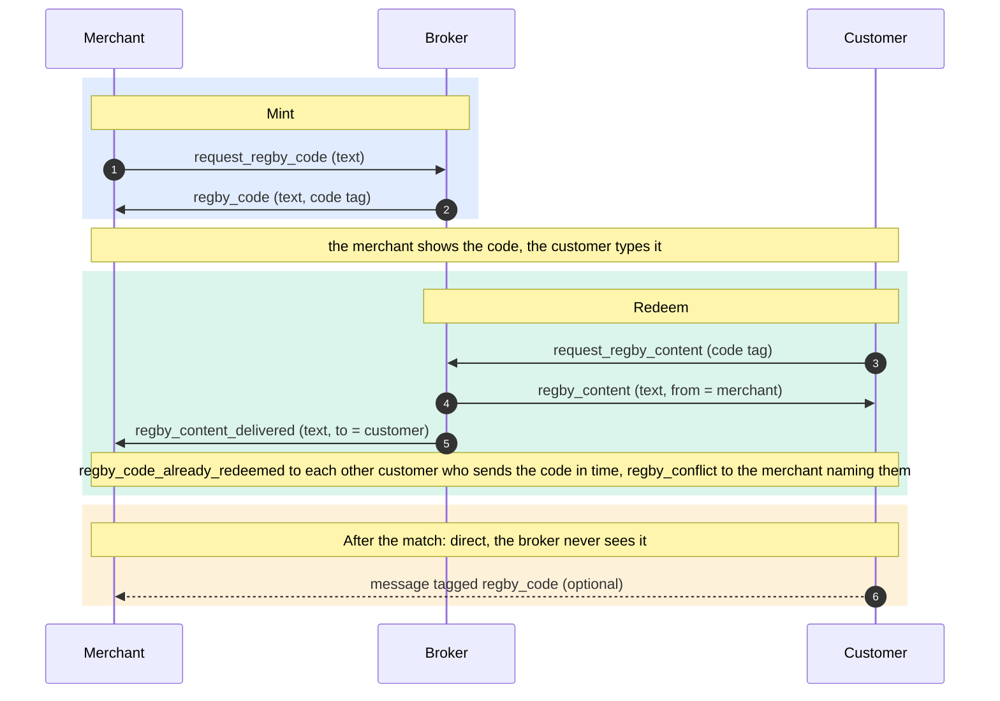

ReGBY
=====

One-Time Codes over Encrypted Direct Messages
---------------------------------------------

`draft` `optional`

ReGBY lets a *merchant* hand a short text to a *customer* through an
eight-digit one-time code. A *broker*, a service with its own Nostr key, stores
the text and releases it to the first customer who sends the code. Both users
then learn each other's public key.

All messages are [NIP-04](https://github.com/nostr-protocol/nips/blob/master/04.md)
encrypted direct messages (`kind:4`). The broker does not interpret the text.
The usual payload is a `defito://` payment request.

## Terms

- **merchant**: the user who sends the text.
- **customer**: the user who types the code and receives the text.
- **broker**: the service that mints and redeems codes. Its public key is
  published by its operator.
- **code**: exactly eight decimal digits.
- **match**: a successful redeem. After it, merchant and customer know each
  other's public keys.

## Flow

1. Merchant to broker: `request_regby_code`. Content is the text.
2. Broker to merchant: `regby_code`. Content is the text again; the
   `regby_code` tag carries the code.
3. The merchant shows the code. Customer to broker: `request_regby_content`.
   Content is empty; the `regby_code` tag carries the code.
4. Broker to customer: `regby_content`. Content is the text; `from` names the
   merchant.
5. Broker to merchant: `regby_content_delivered`. Content is the text; `to`
   names the customer. Every other customer who sends event 3 while the code
   is valid gets `regby_code_already_redeemed` instead of event 4, and the
   merchant gets a `regby_conflict` naming them. The merchant MUST show it as
   a warning, and the exchange starts over with a new code; see
   [Several customers](#several-customers).
6. *Optional.* Customer to merchant, directly: the customer's first message to
   the merchant after the match, for example a `defifrom://` payment
   confirmation, tagged with the code so the merchant can recognise the
   sender. See [Event 6](#event-6).



Events 1 to 5 are the protocol: they go through the broker and the broker
enforces them. Event 6 is a message between the two users that ReGBY only
tags; the broker never sees it.

## Event format

This section applies to events 1 to 5. Event 6 is defined in
[Event 6](#event-6).

All are `kind:4` events.

- `content` is the NIP-04 ciphertext of the raw text, with no JSON wrapper. It
  is never the code: the code travels only in the `regby_code` tag.
- An empty value is sent as `""`, not encrypted. A receiver MUST check for
  `""` before decrypting.
- Each event MUST carry:
  - `["p", <recipient pubkey>]`
  - `["i", <intent>]`
  - `["expiration", <unix seconds>]` ([NIP-40](https://github.com/nostr-protocol/nips/blob/master/40.md)),
    at most 72 hours after `created_at`
  - `["client", <client name>]`
- Every broker reply MUST carry `["e", <id of the event it answers>]`. This is
  the only link between a request and its reply.

ReGBY-specific tags:

| tag | value | on |
| --- | --- | --- |
| `regby_code` | the code | events 2, 3, 4 and 5, `regby_conflict`, and every failure except `regby_code_busy`. SHOULD on event 6. |
| `from` | merchant pubkey | event 4 |
| `to` | customer pubkey | event 5 and `regby_conflict` |

Pubkeys are 32-byte lowercase hex. All tags are plaintext; see
[Relays](#relays).

NIP-04 does not authenticate the sender. A receiver MUST verify the event
signature and MUST NOT treat a successful decrypt as proof of who sent it.

## Intents

| event | intent | sender to recipient | content |
| --- | --- | --- | --- |
| 1 | `request_regby_code` | merchant to broker | text, 0 to 4096 characters |
| 2 | `regby_code` | broker to merchant | text, exactly as sent in event 1 |
| 3 | `request_regby_content` | customer to broker | `""` |
| 4 | `regby_content` | broker to customer | text, exactly as sent in event 1 |
| 5 | `regby_content_delivered` | broker to merchant | text, exactly as received in event 4 |
| 5, conflict | `regby_conflict` | broker to merchant | `""` |

Failures replace event 2 or event 4. Their content is `""`, and they carry
no `from` or `to` tag.

| intent | replaces | meaning |
| --- | --- | --- |
| `regby_code_busy` | event 2 | No code available. No `regby_code` tag. |
| `regby_code_already_redeemed` | event 4 | Code already redeemed by another pubkey, still inside its first minute. |
| `regby_code_expired` | event 4 | Code between 1 minute and 1 hour old, used or not. |
| `regby_code_locked` | event 4 | Code between 1 hour and 72 hours old. |
| `regby_code_not_found` | event 4 | Code never issued, or over 72 hours old. |

A client MUST read `i` before `content`, since a success can also carry `""`.
A client ignores intents it does not know, so a broker MUST NOT send a new
intent before clients support it.

## Examples

Content is shown decrypted. Pubkeys are shortened.

Event 1, merchant to broker:

```json
{
  "kind": 4,
  "pubkey": "<merchant>",
  "created_at": 1750579200,
  "tags": [
    ["p", "<broker>"],
    ["i", "request_regby_code"],
    ["expiration", "1750838340"],
    ["client", "<merchant client>"]
  ],
  "content": "defito://base/0x075e…&amount=EURC:1.00&order_id=9f2c…&valid_until=1750580100",
  "id": "<event 1 id>"
}
```

Event 2, broker to merchant:

```json
{
  "kind": 4,
  "pubkey": "<broker>",
  "created_at": 1750579201,
  "tags": [
    ["p", "<merchant>"],
    ["e", "<event 1 id>"],
    ["i", "regby_code"],
    ["expiration", "1750838341"],
    ["client", "regby-middleware"],
    ["regby_code", "42891337"]
  ],
  "content": "defito://base/0x075e…&amount=EURC:1.00&order_id=9f2c…&valid_until=1750580100"
}
```

Event 3, customer to broker:

```json
{
  "kind": 4,
  "pubkey": "<customer>",
  "created_at": 1750579230,
  "tags": [
    ["p", "<broker>"],
    ["i", "request_regby_content"],
    ["expiration", "1750838370"],
    ["client", "<customer client>"],
    ["regby_code", "42891337"]
  ],
  "content": "",
  "id": "<event 3 id>"
}
```

Event 4, broker to customer:

```json
{
  "kind": 4,
  "pubkey": "<broker>",
  "created_at": 1750579231,
  "tags": [
    ["p", "<customer>"],
    ["e", "<event 3 id>"],
    ["i", "regby_content"],
    ["expiration", "1750838371"],
    ["client", "regby-middleware"],
    ["regby_code", "42891337"],
    ["from", "<merchant>"]
  ],
  "content": "defito://base/0x075e…&amount=EURC:1.00&order_id=9f2c…&valid_until=1750580100"
}
```

Event 5, broker to merchant:

```json
{
  "kind": 4,
  "pubkey": "<broker>",
  "created_at": 1750579232,
  "tags": [
    ["p", "<merchant>"],
    ["e", "<event 1 id>"],
    ["i", "regby_content_delivered"],
    ["expiration", "1750838372"],
    ["client", "regby-middleware"],
    ["regby_code", "42891337"],
    ["to", "<customer>"]
  ],
  "content": "defito://base/0x075e…&amount=EURC:1.00&order_id=9f2c…&valid_until=1750580100"
}
```

A conflict, broker to merchant, for a second customer who typed the code
after the first one got it. That customer gets `regby_code_already_redeemed`
in place of event 4, a plain failure like the one below. The merchant's
notice:

```json
{
  "kind": 4,
  "pubkey": "<broker>",
  "created_at": 1750579233,
  "tags": [
    ["p", "<merchant>"],
    ["e", "<event 1 id>"],
    ["i", "regby_conflict"],
    ["expiration", "1750838373"],
    ["client", "regby-middleware"],
    ["regby_code", "42891337"],
    ["to", "<second customer>"]
  ],
  "content": ""
}
```

A failure, broker to customer:

```json
{
  "kind": 4,
  "pubkey": "<broker>",
  "created_at": 1750579300,
  "tags": [
    ["p", "<customer>"],
    ["e", "<event 3 id>"],
    ["i", "regby_code_expired"],
    ["expiration", "1750838440"],
    ["client", "regby-middleware"],
    ["regby_code", "42891337"]
  ],
  "content": ""
}
```

## Code validity

A code's age is measured from the `created_at` of event 1. The broker clamps
that value to its own clock within a small skew.

| code age | event 3 is answered with |
| --- | --- |
| under 1 minute, not redeemed | event 4, then event 5 |
| under 1 minute, redeemed by this pubkey | event 4 again, and no further event 5 |
| under 1 minute, redeemed by another pubkey | `regby_code_already_redeemed`, then a `regby_conflict` to the merchant if this pubkey has not sent the code before |
| 1 minute to 1 hour | `regby_code_expired` |
| 1 hour to 72 hours | `regby_code_locked` |
| over 72 hours, or never issued | `regby_code_not_found` |

- A code MUST be redeemed at most once. The broker consumes it before it
  replies, so a reply that reaches no relay still uses the code up. Only the
  pubkey that redeemed it gets event 4 again, and only while the code is under
  1 minute old: a retry after a lost reply or a reload, not a second use.
- The broker MUST NOT issue the same code again within 72 hours. After that the
  number may be reused, so a code alone does not identify an exchange.

### Several customers

A code shown on a screen can reach more than one customer. Only the first one
to send event 3 gets event 4; the merchant hears about all of them.

A conflict is a security signal, not a routine error. Either customer may be
the victim: whoever was first may have read the code off the merchant's screen
and beaten the real customer to it, who is then the one refused. Nothing in the
protocol tells the merchant which pubkey is the customer at the counter, so a
conflict voids the exchange: the merchant starts over with a new event 1, and
the customer types the new code. The customer who got event 4 is never told
about the conflict; the merchant tells them in person.

- The customer who got event 4 is named in event 5, `regby_content_delivered`,
  sent once per code. Sending event 3 again while the code is under 1 minute
  old gets them event 4 again, and the merchant no further event 5.
- Any other pubkey that sends event 3 while the code is under 1 minute old
  gets `regby_code_already_redeemed` in place of event 4.
- The broker MUST also send the merchant a `regby_conflict` once for each such
  distinct pubkey: `e` naming event 1 and `to` naming that customer, like
  event 5. Its own intent, so a refused customer is never read as the one who
  got the text, even when event 5 itself is lost.
- `regby_conflict` carries no text (`""`).
- A pubkey already named in a conflict that sends the code again gets
  `regby_code_already_redeemed` again, and the merchant no further notice.
- The broker MUST date each notice at least one second after the customer's
  own reply (event 4 or the refusal), so clients that list by `created_at`
  show the reply first.
- The broker MUST date the notices of a code at least one second apart, in
  the order their customers arrived, even when two customers send the code in
  the same second.
- An event 3 past the first minute gets `regby_code_expired`, the winner's
  included, and no notice.

## Broker behavior

The broker:

- MUST subscribe to `kind:4` events with `#p` set to its own pubkey and `#i`
  set to `request_regby_code` and `request_regby_content`.
- MUST drop, without replying, an event 1 whose text is over 4096 characters
  or contains binary data (U+FFFD, NUL, or a control character other than tab,
  line feed, vertical tab, form feed and carriage return).
- MUST read the code of event 3 from its first `regby_code` tag, and MUST
  drop, without replying, an event 3 whose tag is missing or not eight digits
  after trimming. It MUST ignore the content of event 3 and need not decrypt it.
- MUST set `from` on event 4 to the pubkey that signed event 1, never to
  anything named inside the text.
- MUST send event 5 after a successful event 4, even if no relay accepted
  event 4, and `regby_code_already_redeemed` to every other customer and a
  `regby_conflict` to the merchant as in
  [Several customers](#several-customers).
- MUST send event 4 again only to the pubkey that redeemed the code, and only
  while the code is under 1 minute old.
- SHOULD rate-limit each sender and the total mint and redeem rate, which also
  bounds how many event 5s one code can cause, and MAY
  stop answering a sender after repeated `regby_code_not_found` or
  `regby_code_locked` answers.

## Client behavior

Merchant clients:

- MUST subscribe to `#e` with the id of event 1, `authors` set to the broker,
  before publishing event 1.
- MUST read the code from the `regby_code` tag of event 2, not its content.
- SHOULD show the code with a one-minute countdown from their own event 1
  `created_at`.
- MUST recognise event 5 and `regby_conflict` by their `e` tag naming their
  event 1. Event 5 names the customer who received the text; each conflict
  names a customer who was refused.
- MUST show a prominent warning on any `regby_conflict`: more than one pubkey
  typed the code, and the one named in event 5 may not be the customer in
  front of them.
- SHOULD then treat the exchange as void: stop showing the code, not rely on
  event 5, and offer to start over with a new event 1.

Customer clients:

- MUST send the code as the `regby_code` tag on event 3, with content `""`.
- MUST accept a reply only if it is signed by the broker and its `e` tag names
  their event 3.
- MAY send event 3 again for the same code while it is under 1 minute old, for
  example after a lost reply, and get event 4 again.
- On `regby_code_already_redeemed`, SHOULD tell the user someone else
  redeemed the code first and ask the merchant for a new code. The user
  SHOULD NOT go on with the exchange.
- MUST treat the text as untrusted input and validate it. For a payment
  request, the user confirms recipient and amount before signing anything.

## After the match

After event 5 the broker is done. The customer knows the merchant's pubkey
(`from`) and the merchant knows the customer's (`to`), so from here on they
message each other directly. ReGBY does not define those messages. It defines
one tag that links them back to the exchange, and how the merchant uses it.

Everything in this section is optional for clients. The broker takes no part
in it.

### Event 6

**Event 6 is the customer's direct message to the merchant about the exchange,
tagged with the code.**

In the payment case it is the `defifrom://` payment confirmation: the
customer has paid the request it received in event 4, and once the payment
confirms on chain, its wallet tells the merchant what was sent. Any other
message about the same exchange works the same way.

| property | value |
| --- | --- |
| sender | the customer |
| recipient | the merchant, that is the `from` of event 4 |
| route | directly, on relays both users read. Not through the broker. |
| when | whenever the customer's application has something to send about the exchange, for example once a payment confirms |
| kind | `4`, NIP-04, like events 1 to 5 |
| content | defined by the application, for example a `defifrom://` confirmation. ReGBY does not read or change it. |
| tags | `p` (the merchant), `expiration`, `client`, and `["regby_code", <code>]` |

It carries no `i` tag: it is not addressed to the broker and is not a ReGBY
intent.

**Why the tag.** Before the match the merchant had never seen the customer's
pubkey, so without the tag event 6 looks like a message from a stranger. Many
clients hide such messages in a spam or message-requests folder, and a
merchant serving the same customer twice cannot tell which exchange a message
is about. The tag names the exchange; the merchant checks it against the
[match record](#match-records) it saved on event 5.

Example, a payment confirmation:

```json
{
  "kind": 4,
  "pubkey": "<customer>",
  "created_at": 1750579290,
  "tags": [
    ["p", "<merchant>"],
    ["expiration", "1750838490"],
    ["client", "<customer client>"],
    ["regby_code", "42891337"]
  ],
  "content": "defifrom://base/0x075e…&amount=EURC:1.00&order_id=9f2c…&tx=0xb9f9…&nostr=npub1…"
}
```

Rules for the customer client:

- It SHOULD add the `regby_code` tag to event 6.
- It MUST add the tag only when the recipient is the `from` of event 4. The
  text may name someone else (an invoice's `nostr=` field, for example), and a
  user who never minted the code has no record of it.
- The value MUST be the code from its own event 3 that event 4 answered.
- It SHOULD leave the tag out when the message goes to relays that do not meet
  [Relays](#relays).
- A message that did not follow a ReGBY exchange (a scanned QR code, a pasted
  link) is not event 6 and carries no tag.

### Match records

For each code, a merchant client SHOULD store a record of its event 5:

| field | value |
| --- | --- |
| `code` | the code it minted (event 2) |
| `customer` | the `to` tag of event 5 |
| `content` | the text it sent in event 1 |
| `matched_at` | the `created_at` of event 5 |

- One record per code. A `regby_conflict` names a customer who was refused;
  a client shows it as a warning, but MUST NOT record it as a match. Since a
  conflict voids the exchange, the client SHOULD also drop the code's record
  from event 5, so whoever got the text is not recognised by it.
- The same customer can have many records with different codes.
- A record MUST NOT be looked up by `code` alone, because codes are reused
  after 72 hours.
- Clients SHOULD bound records by age and count.

### Recognising the customer

When a direct message with a `regby_code` tag arrives, a merchant client
SHOULD look for a record whose `code` equals the tag and whose `customer`
equals the event's `pubkey`.

- If one exists, the sender is a known counterparty: the client SHOULD show the
  message in the inbox rather than a spam or message-requests folder, and MAY
  link it to the exchange.
- Otherwise the message is treated like any other from an unknown sender.

The `pubkey` is covered by the signature; the tag is whatever the sender wrote.
Both MUST match, so copying someone else's code gains nothing.

## Relays

ReGBY tags, including live codes, are plaintext. Relays carrying ReGBY events
MUST:

- serve a `kind:4` event only to its author and its `p` recipient, after
  [NIP-42](https://github.com/nostr-protocol/nips/blob/master/42.md)
  authentication;
- honour NIP-40 expiration.

On a relay without the first rule, anyone could read the code from event 2
and redeem it before the customer. A broker MUST NOT use such a relay.

The reference relays are `wss://dm1.zentext.me`, `wss://dm2.nostr.box` and
`wss://dm3.npub.cx`. They accept only `kind:4`, require a `client` tag, cap
`expiration` at 72 hours and cap the encrypted content at 4 KB, which is about
3000 ASCII characters of text.

## Security considerations

- **The broker sees the text.** It stores the plaintext until the code ages
  out, so a compromised broker could serve different text. Recipients MUST
  validate it.
- **Relay operators see the tags**, including which pubkeys exchanged a code.
- **Codes are guessable in principle.** There are 10^8 codes, each valid for
  one minute; rate limits and blocking repeat guessers keep guessing
  impractical.
- **Typing a code reveals your pubkey to the merchant.** Every customer who
  sends a live code is named to the merchant, in event 5 or a
  `regby_conflict`, including those refused because someone else was first.
- **A conflict may mean the code was intercepted.** Whoever types a live code
  first gets the text, so someone who reads it off the merchant's screen can
  beat the real customer to it. That is why the merchant MUST be warned on a
  `regby_conflict`, and why the exchange starts over with a new code instead
  of trusting the pubkey in event 5.
- **No conflict, no warning.** If someone redeems a code read off the screen
  and the real customer types it only after its minute, the real customer gets
  `regby_code_expired`, not a conflict, and neither side is warned. The
  merchant still has the pubkey in event 5, and starts over if the customer in
  front of them says they did not get the text.
- **Event 6 reveals the link.** Its tag shows that a message belongs to a
  ReGBY exchange. The code is already spent and cannot be redeemed again.
