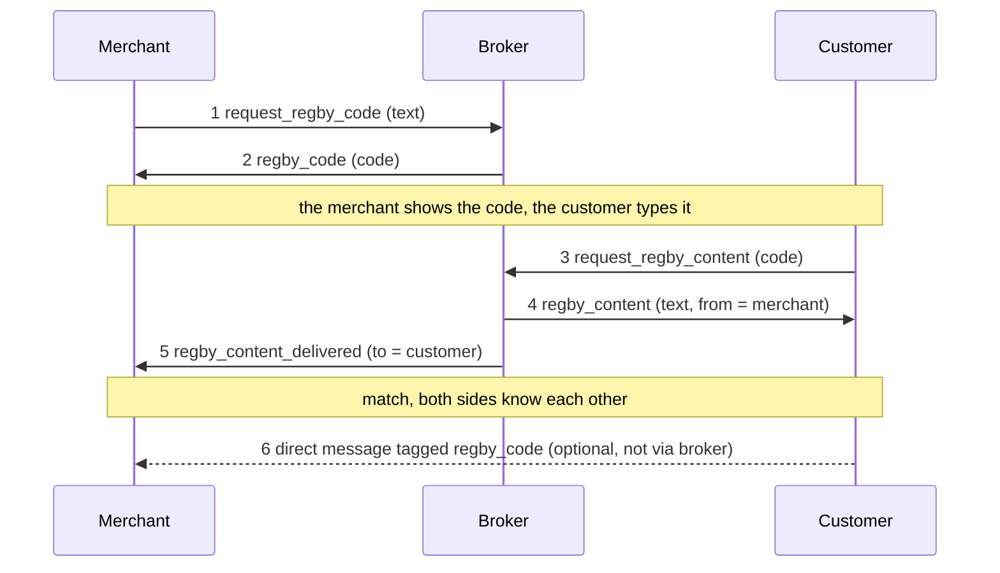

ReGBY
=====

One-Time Codes over Encrypted Direct Messages
---------------------------------------------

`draft` `optional`

ReGBY lets a *merchant* hand a short text to a *customer* through an
eight-digit one-time code. A *broker*, a service with its own Nostr key, stores
the text and releases it to the first customer who sends the code. Both users
then learn each other's public key.

All messages are [NIP-04](https://github.com/nostr-protocol/nips/blob/master/04.md)
encrypted direct messages (`kind:4`). The broker does not interpret the text.
The usual payload is a `defito://` payment request.

## Terms

- **merchant**: the user who sends the text.
- **customer**: the user who types the code and receives the text.
- **broker**: the service that mints and redeems codes. Its public key is
  published by its operator.
- **code**: exactly eight decimal digits.
- **match**: a successful redeem. After it, merchant and customer know each
  other's public keys.

## Flow

1. Merchant to broker: `request_regby_code`. Content is the text.
2. Broker to merchant: `regby_code`. Content is the code.
3. The merchant shows the code. Customer to broker: `request_regby_content`.
   Content is the code.
4. Broker to customer: `regby_content`. Content is the text; `from` names the
   merchant.
5. Broker to merchant: `regby_content_delivered`. `to` names the customer.
6. *Optional.* Customer to merchant, directly: the customer's first message to
   the merchant after the match, for example a `defifrom://` payment
   confirmation, tagged with the code so the merchant can recognise the
   sender. See [Event 6](#event-6).



Events 1 to 5 are the protocol: they go through the broker and the broker
enforces them. Event 6 is a message between the two users that ReGBY only
tags; the broker never sees it.

## Event format

This section applies to events 1 to 5. Event 6 is defined in
[Event 6](#event-6).

All are `kind:4` events.

- `content` is the NIP-04 ciphertext of the raw value, the text or the code,
  with no JSON wrapper.
- An empty value is sent as `""`, not encrypted. A receiver MUST check for
  `""` before decrypting.
- Each event MUST carry:
  - `["p", <recipient pubkey>]`
  - `["i", <intent>]`
  - `["expiration", <unix seconds>]` ([NIP-40](https://github.com/nostr-protocol/nips/blob/master/40.md)),
    at most 72 hours after `created_at`
  - `["client", <client name>]`
- Every broker reply MUST carry `["e", <id of the event it answers>]`. This is
  the only link between a request and its reply.

ReGBY-specific tags:

| tag | value | on |
| --- | --- | --- |
| `regby_code` | the code | events 2, 4 and 5 and every failure except `regby_code_busy`. SHOULD on event 3 and event 6. |
| `from` | merchant pubkey | event 4 |
| `to` | customer pubkey | event 5 |

Pubkeys are 32-byte lowercase hex. All tags are plaintext; see
[Relays](#relays).

NIP-04 does not authenticate the sender. A receiver MUST verify the event
signature and MUST NOT treat a successful decrypt as proof of who sent it.

## Intents

| event | intent | sender to recipient | content |
| --- | --- | --- | --- |
| 1 | `request_regby_code` | merchant to broker | text, 0 to 4096 characters |
| 2 | `regby_code` | broker to merchant | code |
| 3 | `request_regby_content` | customer to broker | code |
| 4 | `regby_content` | broker to customer | text, exactly as sent in event 1 |
| 5 | `regby_content_delivered` | broker to merchant | code |

Failures replace event 2 or event 4. Their content is `""` and they carry no
`from` or `to` tag.

| intent | replaces | meaning |
| --- | --- | --- |
| `regby_code_busy` | event 2 | No code available. No `regby_code` tag. |
| `regby_code_already_redeemed` | event 4 | Code used, still inside its first minute. |
| `regby_code_expired` | event 4 | Code between 1 minute and 1 hour old, used or not. |
| `regby_code_locked` | event 4 | Code between 1 hour and 72 hours old. |
| `regby_code_not_found` | event 4 | Code never issued, or over 72 hours old. |

A client MUST read `i` before `content`, since a success can also carry `""`.
A client ignores intents it does not know, so a broker MUST NOT send a new
intent before clients support it.

## Examples

Content is shown decrypted. Pubkeys are shortened.

Event 1, merchant to broker:

```json
{
  "kind": 4,
  "pubkey": "<merchant>",
  "created_at": 1750579200,
  "tags": [
    ["p", "<broker>"],
    ["i", "request_regby_code"],
    ["expiration", "1750838340"],
    ["client", "<merchant client>"]
  ],
  "content": "defito://base/0x075e…&amount=EURC:1.00&order_id=9f2c…&valid_until=1750580100",
  "id": "<event 1 id>"
}
```

Event 2, broker to merchant:

```json
{
  "kind": 4,
  "pubkey": "<broker>",
  "created_at": 1750579201,
  "tags": [
    ["p", "<merchant>"],
    ["e", "<event 1 id>"],
    ["i", "regby_code"],
    ["expiration", "1750838341"],
    ["client", "regby-middleware"],
    ["regby_code", "42891337"]
  ],
  "content": "42891337"
}
```

Event 3, customer to broker:

```json
{
  "kind": 4,
  "pubkey": "<customer>",
  "created_at": 1750579230,
  "tags": [
    ["p", "<broker>"],
    ["i", "request_regby_content"],
    ["expiration", "1750838370"],
    ["client", "<customer client>"],
    ["regby_code", "42891337"]
  ],
  "content": "42891337",
  "id": "<event 3 id>"
}
```

Event 4, broker to customer:

```json
{
  "kind": 4,
  "pubkey": "<broker>",
  "created_at": 1750579231,
  "tags": [
    ["p", "<customer>"],
    ["e", "<event 3 id>"],
    ["i", "regby_content"],
    ["expiration", "1750838371"],
    ["client", "regby-middleware"],
    ["regby_code", "42891337"],
    ["from", "<merchant>"]
  ],
  "content": "defito://base/0x075e…&amount=EURC:1.00&order_id=9f2c…&valid_until=1750580100"
}
```

Event 5, broker to merchant:

```json
{
  "kind": 4,
  "pubkey": "<broker>",
  "created_at": 1750579231,
  "tags": [
    ["p", "<merchant>"],
    ["e", "<event 1 id>"],
    ["i", "regby_content_delivered"],
    ["expiration", "1750838371"],
    ["client", "regby-middleware"],
    ["regby_code", "42891337"],
    ["to", "<customer>"]
  ],
  "content": "42891337"
}
```

A failure, broker to customer:

```json
{
  "kind": 4,
  "pubkey": "<broker>",
  "created_at": 1750579300,
  "tags": [
    ["p", "<customer>"],
    ["e", "<event 3 id>"],
    ["i", "regby_code_expired"],
    ["expiration", "1750838440"],
    ["client", "regby-middleware"],
    ["regby_code", "42891337"]
  ],
  "content": ""
}
```

## Code validity

A code's age is measured from the `created_at` of event 1. The broker clamps
that value to its own clock within a small skew.

| code age | event 3 is answered with |
| --- | --- |
| under 1 minute, not redeemed | event 4, then event 5 |
| under 1 minute, redeemed | `regby_code_already_redeemed` |
| 1 minute to 1 hour | `regby_code_expired` |
| 1 hour to 72 hours | `regby_code_locked` |
| over 72 hours, or never issued | `regby_code_not_found` |

- A code MUST be redeemed at most once. The broker consumes it before it
  replies, so a reply that reaches no relay still uses the code up.
- The broker MUST NOT issue the same code again within 72 hours. After that the
  number may be reused, so a code alone does not identify an exchange.

## Broker behavior

The broker:

- MUST subscribe to `kind:4` events with `#p` set to its own pubkey and `#i`
  set to `request_regby_code` and `request_regby_content`.
- MUST drop, without replying, an event 1 whose text is over 4096 characters
  or contains binary data (U+FFFD, NUL, or a control character other than tab,
  line feed, vertical tab, form feed and carriage return).
- MUST drop, without replying, an event 3 whose content is not eight digits
  after trimming. It MUST read the code from the content and MUST ignore a
  `regby_code` tag on event 3.
- MUST set `from` on event 4 to the pubkey that signed event 1, never to
  anything named inside the text.
- MUST send event 5 after a successful event 4, even if no relay accepted
  event 4.
- SHOULD rate-limit each sender and the total mint and redeem rate, and MAY
  stop answering a sender after repeated `regby_code_not_found` or
  `regby_code_locked` answers.

## Client behavior

Merchant clients:

- MUST subscribe to `#e` with the id of event 1, `authors` set to the broker,
  before publishing event 1.
- SHOULD show the code with a one-minute countdown from their own event 1
  `created_at`.
- MUST recognise event 5 by its `e` tag naming their event 1.

Customer clients:

- SHOULD send the code both as content and as a `regby_code` tag on event 3.
- MUST accept a reply only if it is signed by the broker and its `e` tag names
  their event 3.
- MUST treat the text as untrusted input and validate it. For a payment
  request, the user confirms recipient and amount before signing anything.

## After the match

After event 5 the broker is done. The customer knows the merchant's pubkey
(`from`) and the merchant knows the customer's (`to`), so from here on they
message each other directly. ReGBY does not define those messages. It defines
one tag that links them back to the exchange, and how the merchant uses it.

Everything in this section is optional for clients. The broker takes no part
in it.

### Event 6

**Event 6 is the customer's direct message to the merchant about the exchange,
tagged with the code.**

In the payment case it is the `defifrom://` payment confirmation: the
customer has paid the request it received in event 4, and once the payment
confirms on chain, its wallet tells the merchant what was sent. Any other
message about the same exchange works the same way.

| property | value |
| --- | --- |
| sender | the customer |
| recipient | the merchant, that is the `from` of event 4 |
| route | directly, on relays both users read. Not through the broker. |
| when | whenever the customer's application has something to send about the exchange, for example once a payment confirms |
| kind | `4`, NIP-04, like events 1 to 5 |
| content | defined by the application, for example a `defifrom://` confirmation. ReGBY does not read or change it. |
| tags | `p` (the merchant), `expiration`, `client`, and `["regby_code", <code>]` |

It carries no `i` tag: it is not addressed to the broker and is not a ReGBY
intent.

**Why the tag.** Before the match the merchant had never seen the customer's
pubkey, so without the tag event 6 looks like a message from a stranger. Many
clients hide such messages in a spam or message-requests folder, and a
merchant serving the same customer twice cannot tell which exchange a message
is about. The tag names the exchange; the merchant checks it against the
[match record](#match-records) it saved on event 5.

Example, a payment confirmation:

```json
{
  "kind": 4,
  "pubkey": "<customer>",
  "created_at": 1750579290,
  "tags": [
    ["p", "<merchant>"],
    ["expiration", "1750838490"],
    ["client", "<customer client>"],
    ["regby_code", "42891337"]
  ],
  "content": "defifrom://base/0x075e…&amount=EURC:1.00&order_id=9f2c…&tx=0xb9f9…&nostr=npub1…"
}
```

Rules for the customer client:

- It SHOULD add the `regby_code` tag to event 6.
- It MUST add the tag only when the recipient is the `from` of event 4. The
  text may name someone else (an invoice's `nostr=` field, for example), and a
  user who never minted the code has no record of it.
- The value MUST be the code from its own event 3 that event 4 answered.
- It SHOULD leave the tag out when the message goes to relays that do not meet
  [Relays](#relays).
- A message that did not follow a ReGBY exchange (a scanned QR code, a pasted
  link) is not event 6 and carries no tag.

### Match records

On each event 5, a merchant client SHOULD store a record:

| field | value |
| --- | --- |
| `code` | the code it minted (event 2) |
| `customer` | the `to` tag of event 5 |
| `content` | the text it sent in event 1 |
| `matched_at` | the `created_at` of event 5 |

- One record per event 5. The same customer can have many records with
  different codes.
- A record MUST NOT be looked up by `code` alone, because codes are reused
  after 72 hours.
- Clients SHOULD bound records by age and count.

### Recognising the customer

When a direct message with a `regby_code` tag arrives, a merchant client
SHOULD look for a record whose `code` equals the tag and whose `customer`
equals the event's `pubkey`.

- If one exists, the sender is a known counterparty: the client SHOULD show the
  message in the inbox rather than a spam or message-requests folder, and MAY
  link it to the exchange.
- Otherwise the message is treated like any other from an unknown sender.

The `pubkey` is covered by the signature; the tag is whatever the sender wrote.
Both MUST match, so copying someone else's code gains nothing.

## Relays

ReGBY tags, including live codes, are plaintext. Relays carrying ReGBY events
MUST:

- serve a `kind:4` event only to its author and its `p` recipient, after
  [NIP-42](https://github.com/nostr-protocol/nips/blob/master/42.md)
  authentication;
- honour NIP-40 expiration.

On a relay without the first rule, anyone could read the code from event 2
and redeem it before the customer. A broker MUST NOT use such a relay.

The reference relays are `wss://dm1.zentext.me`, `wss://dm2.nostr.box` and
`wss://dm3.npub.cx`. They accept only `kind:4`, require a `client` tag, cap
`expiration` at 72 hours and cap the encrypted content at 4 KB, which is about
3000 ASCII characters of text.

## Security considerations

- **The broker sees the text.** It stores the plaintext until the code ages
  out, so a compromised broker could serve different text. Recipients MUST
  validate it.
- **Relay operators see the tags**, including which pubkeys exchanged a code.
- **Codes are guessable in principle.** There are 10^8 codes, each valid for
  one minute; rate limits and blocking repeat guessers keep guessing
  impractical.
- **Event 6 reveals the link.** Its tag shows that a message belongs to a
  ReGBY exchange. The code is already spent and cannot be redeemed again.
